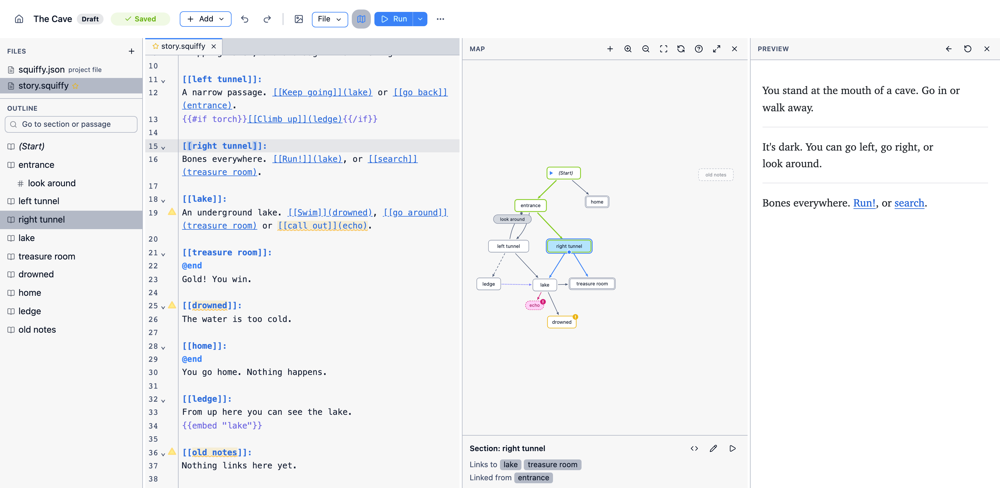

The Squiffy editor at [app.squiffystory.com](https://app.squiffystory.com/) runs entirely in your browser, with no account needed. It's also a [desktop app](/desktop-app/) for Mac, Windows and Linux. Your story's files and outline are on the left, the script in the middle, and a playable version of your story on the right.

## Starting out

The home page lets you start a new story, open a folder, or open a file.

- **New story** creates a draft, which is kept in your browser.
- **Open folder** opens a story's folder on your computer. This needs **Chrome** or **Edge**, which support the File System Access API. Folders you've opened are listed under **Recent folders**, so you can open them again with a click. Your browser may ask for permission again.
- **Open file** copies a `.squiffy` file, or a project `.zip`, into a new draft.

Your drafts are listed on the home page too.

## Saving your work

The editor saves as you go, a moment after you stop typing, and the toolbar shows whether everything is saved. Press Ctrl+S (Cmd+S on Mac) to save straight away.

Drafts are kept in your browser's storage, which the browser can clear, and they aren't shared between browsers or devices. To keep a copy of a draft, use **File > Download project (.zip)**. **Open file** brings it back as a new draft. A story in a folder you opened is saved to the files themselves.

## Installing the editor

The editor is a Progressive Web App (PWA). In browsers that support it, such as Chrome and Edge, you can install it from the address bar, and it then opens in its own window like any other app. Once it's been loaded, the editor works offline.

When a new version of Squiffy is ready, a message offers to reload into it. Your work is saved first.

## Files

A story can be split into several `.squiffy` files, each in its own tab. A new story has a [`squiffy.json` project file](/basic-concepts/#stories-in-several-files), which makes every `.squiffy` file in it part of the story, so a file you add with the **+** button in the files list is part of the story straight away. The main file, where the story starts, is marked with a star.

Use a file's **⋯** menu to rename, download or delete it, or to make it the main file, which changes `squiffy.json`. To keep a `.squiffy` file without it being part of the story, choose **Exclude from story**. It's greyed out in the files list, and **Include in story** puts it back.

A story from an earlier version of Squiffy may not have a `squiffy.json`, in which case the main file `@import`s the others. When you add a second `.squiffy` file or make a different file the main one, the editor offers to add a `squiffy.json`. If the folder already has other `.squiffy` files, it asks first, so you can leave out any that belong to something else. If you'd rather not, it adds an `@import` for a new file instead. Adding a `squiffy.json` also converts the story's `@set` and link assignments to [Squiffy 7's rules](/whats-new-7/#setting-attributes), and says what it changed.

**Download project** includes `squiffy.json`, and opening the zip again uses its main file.

## Writing your story

The **Outline** lists the sections and passages in the current file. Choose one to jump straight to it, or search for one with Ctrl+Shift+O (Cmd+Shift+O on Mac).

The **Add** menu inserts:

- A new section or passage. If you select some text first, such as "open the door", that text becomes a link to a new section or passage with the same name.
- Snippets: commonly-used patterns, such as `{{#if}}` blocks and links. You can also define your own. See [Snippets](/snippets/).

The editor understands your story as you write:

- It underlines problems, such as a link to a section that doesn't exist. Hover over a problem to see what's wrong, and in many cases there's a quick fix, such as creating the missing section.
- It warns about a section the player can't reach, because nothing that can be reached from the start of the story links to it (a section that's only shown inside others, with `{{embed}}` or `{{live ... section=...}}`, is fine), and about a "dead end": a section with no links to another section. If a dead end is one of your story's endings, the quick fix marks it with [`@end`](/basic-concepts/#endings).
- As you type a link, it suggests the names of your sections and passages.
- Hover over a link to see the start of the section or passage it goes to.
- Press F12, or Ctrl+click (Cmd+click on Mac), on a link to go to the section or passage. Shift+F12 lists every link to it.
- Press F2 on a section or passage name, or a link to one, to rename it everywhere.

The ⋯ menu has **Find and replace**, and **Collapse all** and **Expand all**, which fold every section and passage so you can see the shape of your story. Undo and Redo are in the toolbar.

## The story map

The map button in the toolbar shows your story as a map: each section is a box, its passages hang underneath it, and links are arrows. The map reads from the top, where the story starts, down towards its endings. The script is still your story: the map is drawn from it, updates as you type, and anything you do on the map changes the script.

- **Click** a section or passage to go to it in the script. Moving the cursor in the script highlights the section it's in on the map.
- **Drag** the background to move around, and scroll or pinch to zoom. The buttons above the map zoom in and out, and fit the whole story in view. **Full screen** gives the map the whole window.
- **Drag a box** to move it. It stays where you put it. Its passages come with it, and so does any box that's linked only to it, while everything else stays put.
- To move several boxes at once, hold Shift and drag across empty space to select them, or Shift+click boxes to add them, then drag any one of them. Click empty space, or press Escape, to let them go.
- Where you've put things is saved in `squiffy.json`, so it's the same next time you open the story, and a section keeps its place if you rename it or move it to another file. A section without a name of its own, started with `+++` or `---`, is saved under what the map calls it, such as `+++Day Two`. If you edit `squiffy.json` while the map's open, it follows: take a position out and that box is laid out again. A story from an earlier version of Squiffy may not have a `squiffy.json`, so the editor adds one, leaving out any `.squiffy` files in the folder that aren't part of the story, so the story stays the same. **Lay out again** forgets where you've put things.
- The **search box** in the outline also fades out the sections and passages that don't match.

### Problems on the map

Links to sections or passages that don't exist end in a red box with the missing name. Sections the player can't reach are faded, with a dashed outline. Dead ends, sections with no way out that aren't marked as an [ending](/basic-concepts/#endings), have an orange outline and a **!**. The start has a ▶, and endings a double outline.

Different kinds of link look different: links to passages are lighter, [embeds](/basic-concepts/#embed-text) are dotted, `squiffy.story.go` in JavaScript is a different colour, and links that only appear inside `{{#if}}` or `{{#unless}}` are dashed. Passages that run on their own, such as [`@last`](/basic-concepts/#turn-counting), are tied to their section with a fine dotted line. The **?** button above the map shows the key.

### Editing from the map

Select a section or passage, then drag the dot under it:

- to another section, to add a link to it, or to a passage in the same section, to add a passage link;
- to an empty space, to add a new section there, with a link to it.

The link goes at the cursor if it's in that section or passage, or else at the end of it. Double-click an empty space, or use **+** above the map, to add a section without a link. Below the map, you can rename the selected section or passage everywhere it's used (or press F2), or run the story from it.

### Testing with the map

When you run your story, the sections and passages the player visits, and the links they take, are outlined in green, so you can see which parts of the story you've tested.

### Using the keyboard

Click the map, or tab to it, then use the arrow keys to move between sections and passages. Enter goes to the selected one in the script, F2 renames it, **+** and **-** zoom, and **0** fits the whole story in view. A screen reader reads out each section's links in and out as you move to it.

## Images and other files

The image button in the toolbar opens **Images and other files**, where you can add images, sounds and fonts to your story. **Insert** puts an image into your story at the cursor, as an `` tag. These files are included when you publish your story.

## Testing your story

**Run** (Ctrl+Enter, or Cmd+Enter on Mac) plays your story next to the script. It updates as you type, so you can see changes straight away without restarting. When you follow a link in the story, the script moves to that section.

- **Run from this section** (Ctrl+Shift+Enter, or Cmd+Shift+Enter on Mac) starts the story from the section the cursor is in.
- **Back** steps backwards through your story, one section or passage at a time. Use it to try a different choice without playing through from the start.
- **Restart** starts your story again.
- **Play in a new tab** opens your story as players will see it.

Below the story, **Attributes** shows the values your story has set. This is useful for checking that your `@set` directives and `{{set}}` helpers are doing what you expect.

On a phone, the editor shows the script, the outline, the map or the story, with buttons in the toolbar to switch between them.

## Publishing your story

When your story is ready, use the **File** menu to publish it. See [Publishing your game](/getting-started/#publishing-your-game) for the options.

## Opening Squiffy 5 stories

If you open a story that uses the Squiffy 5 text processor syntax, such as `{if x:...}`, the editor offers to convert it to Squiffy 6's. Review the changes afterwards, and use Undo if you want to go back. Anything that can't be converted automatically is marked as a problem. See [Upgrading from v5](/whats-new/#upgrading-from-v5).

## Settings

**Settings**, in the ⋯ menu, chooses a light or dark theme (or matching your system) and the size of the text in the script.
