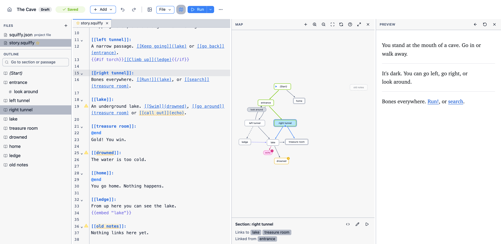

**Code**, **Code + Map** and **Map** in the toolbar choose what the editor shows: just the script, the script with the map beside it, or just the map. The map shows your story with each section is a box, its passages hang underneath it, and links are arrows. The map reads from the top, where the story starts, down towards its endings. A long story folds into columns side by side, like a newspaper's, so that the whole story fits on the screen: each column carries on from the bottom of the one before. The script is still your story: the map is drawn from it, updates as you type, and anything you do on the map changes the script.

- **Click** a section or passage to go to it in the script. Moving the cursor in the script highlights the section it's in on the map.
- **Drag** the background to move around, and scroll or pinch to zoom. The buttons above the map zoom in and out, and fit the whole story in view. The editor remembers which of **Code**, **Code + Map** and **Map** you left a story on, so if you like to work on the map, that's where the story opens next time.
- **Drag a box** to move it. It stays where you put it. Its passages come with it, and so does any box that's linked only to it, while everything else stays put.
- To move several boxes at once, hold Shift and drag across empty space to select them, or Shift+click boxes to add them, then drag any one of them. Click empty space, or press Escape, to let them go.
- Where you've put things is saved in `squiffy.json`, so it's the same next time you open the story, and a section keeps its place if you rename it or move it to another file. A section without a name of its own, started with `+++` or `---`, is saved under what the map calls it, such as `+++Day Two`. If you edit `squiffy.json` while the map's open, it follows: take a position out and that box is laid out again. A story from an earlier version of Squiffy may not have a `squiffy.json`, so the editor adds one, leaving out any `.squiffy` files in the folder that aren't part of the story, so the story stays the same. **Lay out again** forgets where you've put things.
- The **search box** in the outline also fades out the sections and passages that don't match.

## Problems on the map

Links to sections or passages that don't exist end in a red box with the missing name. Sections the player can't reach are faded, with a dashed outline. Dead ends, sections with no way out that aren't marked as an [ending](/basic-concepts/#endings), have an orange outline and a **!**. The start has a ▶, and endings a double outline.

A section that goes somewhere that can't be known until the story is played, such as a link whose target is an expression or JavaScript that works out where to go, has a **?**. Where that's anything the player can reach, the map can't tell which sections are unreachable, so it doesn't fade any. `{{goto}}` with an attribute, as in `{{goto vision}}`, is drawn as a link to each section the story sets that attribute to with the section's name in quotes, such as `{{set "vision" "smoke"}}` or `@set vision = "smoke"`. If the attribute is ever set to anything else, the section has a **?** too.

Different kinds of link look different: links to passages are lighter, [embeds](/basic-concepts/#embed-text) are dotted, [`{{goto}}`](/basic-concepts/#go-to-another-section) and `squiffy.story.go` in JavaScript are a different colour, and links that only appear inside `{{#if}}` or `{{#unless}}` are dashed. Passages that run on their own, such as [`@last`](/basic-concepts/#running-a-passage-after-some-clicks), are tied to their section with a fine dotted line. Long links, such as those to a section much further on or back to the start, are faint, so that they don't hide the links between sections close together: hover over one, or select a section, to see its links clearly. The **?** button above the map shows the key.

## Editing from the map

Select a section or passage, then drag the dot under it:

- to another section, to add a link to it, or to a passage in the same section, to add a passage link;
- to an empty space, to add a new section there, with a link to it.

The link goes on a line of its own at the end of that section or passage. If the script's cursor is in it, and you can see the script, the link goes at the cursor instead. Double-click an empty space, or use **+** above the map, to add a section without a link.

You type a new section's name on the map, where its box will be: press Enter to add it, or Escape to change your mind. Renaming a box, and naming a new passage, work the same way.

A red box is a link to a section or passage that doesn't exist yet. Double-click it (or select it and press Enter) to add what's missing. So you can write `[[the cellar]]` in a section's text, then double-click the red box that appears to make the cellar.

Right-click a section or passage for a menu of what you can do with it. The buttons in the corner of the map do the same for the one that's selected:

- **Rename** it everywhere it's used (or press F2).
- **Add a passage** to the section, with a link to it.
- **Run from here**, to play the story from it.
- **Start the story here**, which sets [`@start`](/basic-concepts/#set-the-start-section) to that section.
- **Delete** it (or press Delete). A section goes with its passages, and with any sections after it started with `+++` or `---`, which carry on from it. A link to it on a line of its own, as the map adds them, is removed too. Links in among other text are left for you to reword: the editor tells you how many will be broken first, and they show on the map in red afterwards, so you can find them. To delete several at once, select them with Shift, then press Delete.

Press Ctrl+Z (Cmd+Z on a Mac) on the map to undo the last thing you did there, whether that changed the script or moved a box, and Ctrl+Shift+Z or Ctrl+Y to redo it. If a change is to a file that isn't open, the editor opens it, so that it can be undone.

### Where new sections go in the script

A section you add from the map goes where it makes sense in the script, not at the end of the file:

- A section added with a link from another goes after the sections that one already leads to, or straight after it if it doesn't lead anywhere yet. So a section's choices follow it in the script, in the order you added them. A section that something earlier in the file links to as well, such as an ending that several sections lead to, doesn't count.
- A section added without a link goes after the selected section, or else after the one nearest to it on the map.
- A new passage goes at the end of its section.

Nothing that's already in the script is moved.

## Writing on the map

You can write your story without leaving the map. Choose **Map** in the toolbar, then double-click a section (or select it and press Enter). Its text opens in a panel over the right of the map, on its own, without the rest of the script around it. The map stays where it is, moving only if the section's box would be hidden under the panel. The map carries on updating as you type.

- A section is shown with its passages, as passage links only work inside their section. Open a passage and its section is shown, with the cursor at that passage.
- The section's name is above its text. Use the pencil there to rename it, which changes every link to it too.
- While a section is open, clicking another box, or moving to it with the arrow keys, shows that one instead. So does going to a link's section or passage, with F12 or from the right-click menu.
- It's the script you're editing, shown a section at a time, so completion, problems, and undo work as they do in the script. The line numbers are the script's.
- The problems list, and Find in Files, open under the map. Choose a problem or a search result to open its section, with the cursor on it.
- Press Escape to go back to the map with the keyboard, leaving the text open. The buttons above the text show it in the whole script (**Show in the whole script**) or close it (**Close**).

Find and Replace search only the section that's open, and count and replace only what's in it. **Add** in the toolbar works here too: select some text, and it becomes a link to a new section or passage with that name. With nothing selected, you type the new one's name on the map.

## Testing with the map

When you run your story, the sections and passages the player visits, and the links they take, are outlined in green, so you can see which parts of the story you've tested.

## Using the keyboard

Click the map, or tab to it, then use the arrow keys to move between sections and passages. Enter goes to the selected one in the script (or, with just the map showing, opens it to [write beside the map](#writing-on-the-map)), F2 renames it, Delete deletes it, and the menu key (or Shift+F10) opens its menu. **+** and **-** zoom, and **0** fits the whole story in view. A screen reader reads out each section's links in and out as you move to it.
