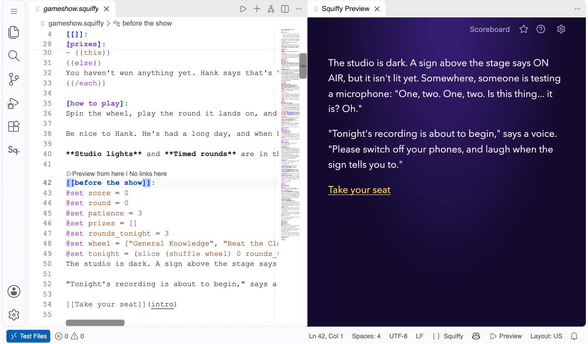
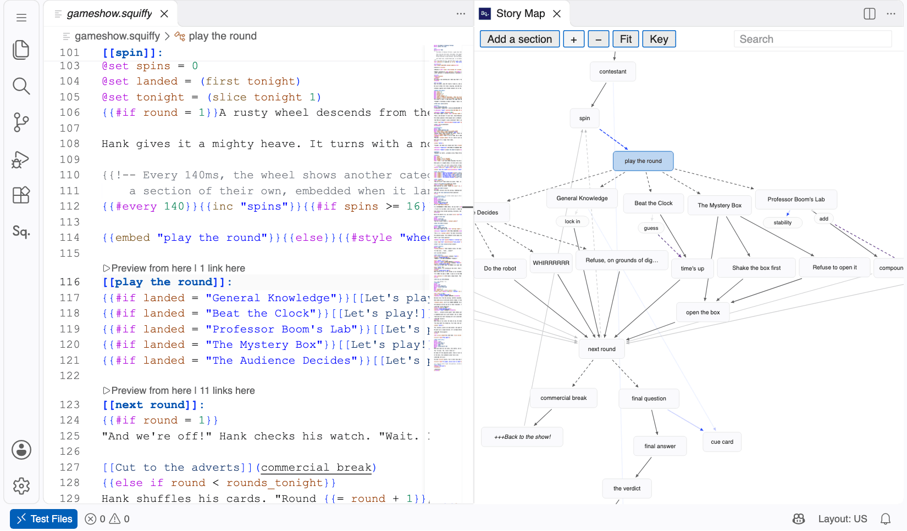

# Squiffy for VS Code

Write [Squiffy](https://squiffystory.com) interactive stories in VS Code, with a live preview and a
story map.

It works in VS Code on the desktop, and on [vscode.dev](https://vscode.dev) and github.dev. To get
started, open the walkthrough on VS Code's Welcome page (**Help > Welcome**), which takes you
through making a story, previewing it, adding sections, the story map and publishing it. There's
more in [Squiffy's documentation](https://squiffystory.com/vscode/).

## Writing

- Syntax highlighting and folding for `.squiffy` files
- Problems as you type, for the whole story, including links to sections that don't exist, dead
  ends and sections nothing links to
- Completion of section and passage names, attributes, directives, helpers (after `{{`, `{{#`,
  `{{/` and `(`) and snippets, hover, and quick fixes
- The Outline view and breadcrumbs, Go to Definition, Find All References and Rename for sections
  and passages
- Above each section and passage, a count of the links to it, which lists them
- **Squiffy: Add Section** and **Add Passage** (also in the editor's context menu, and its title
  bar: **+** and the **...** menu) add a section or passage header at the cursor, to type its name
  into
- **Squiffy: New Story** makes a new story in a folder: a `squiffy.json` and a `story.squiffy` to
  start from. **New Squiffy Story Here** in the Explorer's context menu makes one in that folder.

## The Squiffy sidebar

The Squiffy icon in the Activity Bar opens the Sections view, which lists every section and passage
in the story, across all its files, marking the start, endings, dead ends and sections that can't
be reached. Click one to go to it, or its ▷ to start the preview there. Its buttons run the
preview, add a section, show the story map and export the story, and its **...** menu shares,
publishes or plays it in a browser. In a folder with no story, it offers to make one, or to convert
a Twine story or Quest gamebook.

## Preview

**Squiffy: Show Preview** (also the ▷ button in the editor's title bar, and Preview in the status
bar) runs the story beside the editor, updating as you type. **Preview from here** above each
section and passage, or **Start Preview at This Section** in the editor's context menu, starts it
there. The attributes the story sets are logged in the Squiffy Preview output.

## Story map

**Squiffy: Show Story Map** (also a button in the editor's title bar) shows the story's sections
and passages as boxes and its links as arrows, with problems marked, as the Squiffy editor does.

- Click a box to go to it, and drag from one box to another to add a link
- Right-click a box to rename it, add a passage to it, run the preview from it, start the story
  there, or delete it
- Add a section with the map's button, by double-clicking the background, or by dragging a link to
  empty space, and make a broken link's missing section from its red box
- Search it with the box at its top right (or Ctrl/Cmd+F). The selected box's details, with its
  links in and out, are along the bottom
- Where you've been in the preview is outlined in green, and Key explains the rest
- Where you drag boxes to is kept in `squiffy.json`, as the Squiffy editor keeps it

## Sharing and publishing

- **Squiffy: Share as a Link** copies a squiffystories.com link with the whole story in it (its
  text, and images of up to 4 KB), and offers to open it, or to copy it without the player's Open
  in editor button. **Squiffy: Play in Browser** opens the story's link
- **Squiffy: Publish to textadventures.co.uk** uploads the story, opens textadventures.co.uk to
  finish publishing it there, and says when it's published. The story is given an `id` in its
  `squiffy.json` first if it has none, which is how textadventures.co.uk knows it next time, and a
  story with no `squiffy.json` is given one, with its setters converted to Squiffy 7's rules
- **Squiffy: Export** builds the playable story (`index.html`, `story.js`, the page's stylesheets
  and the story's images, sounds and other files) into a folder, or a zip to upload to a website,
  as the Squiffy editor and command line tool build it. It can also make a single HTML file with
  everything in it, or only `story.js`, for a page of your own

## Converting stories

- **Squiffy: Convert Twine Story** and **Convert Quest Gamebook** convert a Twine story (a `.twee`
  file, or Twine's published or archive HTML) or a Quest gamebook (`.quest` or `.aslx`) into a new
  story folder, with `twine-import.txt` or `quest-import.txt` listing what couldn't be converted
  exactly, and a Quest game's images and sounds. If the folder you choose isn't empty, the story
  goes in a new folder in it
- **Squiffy: Convert from Squiffy 5** converts a Squiffy 5 file's text processor syntax

## Stories and their files

A folder with a `squiffy.json` is a story, made of every `.squiffy`, `.css` and `.js` file in it,
as the Squiffy editor and command line tool see it. A `.squiffy` file anywhere else is part of
the story in its own folder, whose main file is the first one opened there (with the files it
`@import`s). **Squiffy: Use as Main File** picks another.

---

Squiffy is open source, in the [Squiffy repository](https://github.com/textadventures/squiffy) on
GitHub, where you can report problems. To work on the extension itself, see
[DEVELOPMENT.md](https://github.com/textadventures/squiffy/blob/main/vscode/DEVELOPMENT.md).
